<!-- 

<h2 align="left">Hi 👋 I’m Manish Agarwal</h2>
<h4 align="left">Mobile Application Developer</h4>

I enjoy building clean, efficient, and user-focused applications across mobile and web platforms.
I like working close to the system — understanding how things work under the hood — and turning
that understanding into practical, well-designed software.

 

<h3 align="left">🛠️ Tech Stack</h3>

 
  
  
  
  
  
  
  
  
  
  
  
  
  
  
  
  
  
  
  
  
  
  
  
  
  
  
  
  
  

 

<h3 align="left">🌱 What I Care About</h3>

<ul align="left">
  <li>Building reliable, scalable mobile applications</li>
  <li>Performance, optimization, and system-level understanding</li>
  <li>Clean UI backed by solid architecture</li>
  <li>Learning by building and breaking things</li>
</ul>

 

 
  

-->

  

  

